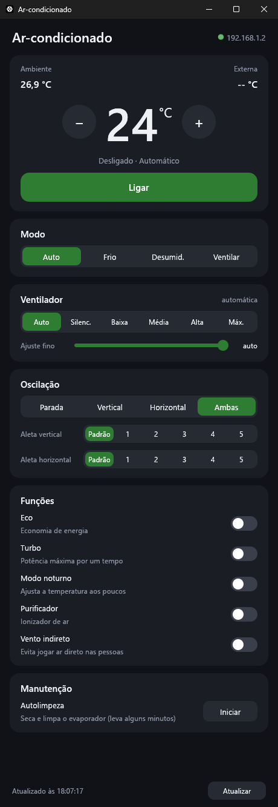
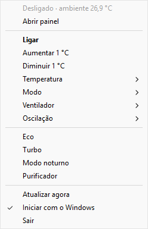

# Ar-condicionado Midea — controle local para Windows

Aplicativo para Windows que controla ar-condicionado Midea **pela rede local**,
sem depender do app do celular nem da nuvem no dia a dia. Fica na bandeja do
sistema e abre um painel com todas as funções do aparelho.

Escrito em Rust, num único executável de ~7 MB, sem instalador e sem runtime.

<p align="center">
  
  &nbsp;&nbsp;
  
</p>

## Funções

- **Painel** com temperatura ambiente e externa, ajuste da temperatura (botões
  ou roda do mouse), modo, ventilador (velocidades fixas e ajuste fino de 1 a
  100%), oscilação, posição das aletas, eco, turbo, modo noturno, purificador,
  vento indireto e autolimpeza. A cor acompanha o modo de operação e o tema
  claro/escuro do Windows.
- **Ícone na bandeja** que mostra a temperatura programada na cor do modo, com
  menu para ligar/desligar e mudar temperatura, modo, ventilador e oscilação.
  Avisa quando o aparelho para de responder.
- **Só mostra o que o aparelho suporta**: as opções vêm das capacidades que o
  próprio aparelho informa.
- **Segue o aparelho se o IP mudar** (DHCP): procura-o na rede pelo ID e
  atualiza a configuração sozinho.
- **Iniciar com o Windows** direto na bandeja.
- **Configuração guiada** na primeira execução: encontra o aparelho na rede e
  obtém a chave de acesso.

<p align="center">
  
</p>

## Requisitos

- Windows 10 ou 11 (x64).
- Ar-condicionado Midea (ou marca que usa a plataforma Midea) com módulo Wi-Fi
  do **protocolo V3**, como o dongle **EU-SK105**, já cadastrado no app
  MSmartHome ou NetHome Plus.
- O computador e o aparelho na mesma rede local.

## Instalação

1. Baixe o `ArCondicionado.exe` da página de
   [Releases](../../releases) ou [compile](#compilação) você mesmo.
2. Coloque o executável numa pasta própria (o app grava o `config.json` e o log
   ao lado dele).
3. Abra o `ArCondicionado.exe`.

### Primeira execução

Sem `config.json`, o app abre a tela de configuração:

1. Ele procura o ar-condicionado na rede e já seleciona o aparelho se houver só
   um.
2. Informe o e-mail e a senha da conta Midea **em que o ar está cadastrado**
   (MSmartHome ou NetHome Plus).
3. Clique em **Obter chave e conectar**. O app busca o token e a key do
   aparelho na nuvem da Midea, confirma que o próprio aparelho os aceita, grava
   o `config.json` e abre o painel.

A conta só é usada nesse momento e **não é gravada**. Depois disso o app
conversa apenas com o aparelho, pela rede local. Não se conhece validade para o
par token/key: nos testes, um par obtido dias antes continuou funcionando, mesmo
depois de a nuvem emitir outro.

> As contas públicas que a msmart-ng embute ainda são tentadas, mas hoje a
> nuvem não entrega mais o token por elas; na prática é preciso usar a sua
> conta.

### Uso

| Ação | Como |
|---|---|
| Abrir o painel | Clique no ícone da bandeja ou abra o `.exe` de novo |
| Esconder o painel | Botão **X** da janela (o app continua na bandeja) |
| Ligar/desligar e atalhos | Botão direito no ícone da bandeja |
| Fechar o app | **Sair**, no menu da bandeja |
| Iniciar com o Windows | **Iniciar com o Windows**, no menu da bandeja |

## Arquivos ao lado do executável

| Arquivo | Conteúdo |
|---|---|
| `config.json` | IP, porta, ID do aparelho, token e key. **Não compartilhe**: quem tem esse arquivo e acesso à sua rede controla o aparelho. Para reconfigurar, apague-o e abra o app. |
| `ar.log` | Log de conexão e erros (até 1 MB, com um backup `ar.log.1`). Não contém token, key nem senha. |

Formato do `config.json`:

```json
{
  "host": "192.168.1.2",
  "port": 6444,
  "device_id": 123456789012345,
  "token": "…128 dígitos hexadecimais…",
  "key": "…64 dígitos hexadecimais…"
}
```

## Como funciona

- **Protocolo:** o aparelho escuta na porta TCP 6444. A conexão começa com um
  handshake (pacotes `8370`) que usa o token e a key para derivar uma chave de
  sessão; os comandos depois vão cifrados com AES-256-CBC e assinados com
  SHA-256, carregando os frames do ar (cabeçalho `AA`, CRC-8).
- **Atualização:** o app consulta o estado a cada 15 s. O aparelho derruba
  conexões paradas por cerca de 30 s, então esse intervalo mantém a conexão
  aberta e cada leitura leva ~0,3 s.
- **Descoberta:** broadcast UDP nas portas 6445 e 20086, usado na configuração
  e quando o aparelho some do IP conhecido.
- **Nuvem:** usada só na configuração, para obter o token e a key
  (`/v1/iot/secure/getToken` das nuvens SmartHome e NetHome Plus).

## Compilação

Precisa do [Rust](https://rustup.rs) (toolchain MSVC) e do Windows SDK (para o
`rc.exe`, que embute o ícone no executável — vem com o Visual Studio Build
Tools).

```powershell
cargo build --release
# executável em target\release\ArCondicionado.exe
```

### Testes e diagnóstico

```powershell
cargo test                           # frames, criptografia e parsing com vetores reais
cargo run --example probe            # lê capacidades e estado (não altera nada)
cargo run --example noop_apply       # reenvia o estado atual (não muda nada)
cargo run --example obter_chave      # testa descoberta + obtenção da chave (não grava)
```

Os exemplos leem o `config.json` da pasta do executável deles
(`target\debug\examples\`).

### Estrutura

| Arquivo | Responsabilidade |
|---|---|
| `src/lan.rs` | Transporte V3 (handshake, AES, pacotes `8370` e `5A5A`) |
| `src/ac.rs` | Frames de comando e resposta do ar-condicionado |
| `src/device.rs` | Estado, capacidades, `refresh` e `apply` |
| `src/discover.rs` | Busca de aparelhos na rede |
| `src/cloud.rs`, `src/setup.rs` | Obtenção do token/key na nuvem |
| `src/controller.rs` | Thread que mantém a conexão e aplica as mudanças |
| `src/main.rs` | Inicialização, instância única, troca configuração → painel |
| `src/panel.rs` | Painel (egui) |
| `src/setup_view.rs` | Tela de configuração |
| `src/tray.rs`, `src/icon.rs` | Ícone e menu da bandeja (Win32) |

## Limitações

- Só Windows.
- Só aparelhos com protocolo **V3**; os V1/V2, mais antigos, não foram
  implementados.
- Testado num aparelho só-frio: o modo Quente e funções que esse aparelho não
  tem (controle do display, umidade, ar fresco etc.) não foram testados.

## Créditos

O protocolo foi portado da biblioteca Python
[msmart-ng](https://github.com/mill1000/midea-msmart) (licença MIT), de Tucker
Kern e colaboradores. Os avisos de licença estão em [LICENSE](LICENSE).

Projeto independente, **sem relação com a Midea**. Midea, MSmartHome e NetHome
Plus são marcas de seus respectivos donos. Use por sua conta e risco.

## Licença

[MIT](LICENSE).
